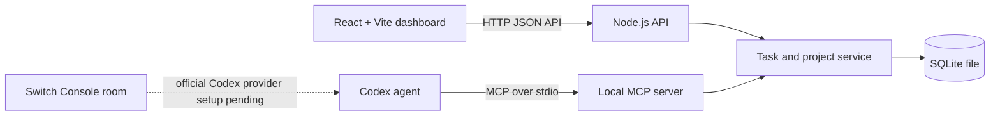

# CHETANVERSE AI ASSISTANT

**Flip the Switch 2026 · Best Personal or Creative Workflow**

Chetanverse is a local-first productivity workspace for organizing tasks, tracking projects, and reviewing daily progress. Its React dashboard and Codex-compatible local MCP server use the same SQLite database, so changes made through the dashboard or an MCP tool are real saved changes.

## What is implemented

- Create, edit, search, filter, complete, and delete tasks.
- Categorize tasks and set priority, due date, status, notes, and project.
- Create, edit, and delete projects, change status and accent color, and view progress calculated from completed linked tasks.
- Review open, due today, completed, overdue, and blocked work in the dashboard and daily summary.
- Keep application task and project data in a local SQLite database.
- Let a connected Codex agent use the local MCP tools to manage the same saved records.

The dashboard does not display pretend AI responses. Codex performs task interpretation when it is connected to the MCP server and calls the real tools.

## Architecture



The dashboard, API, shared service layer, SQLite storage, and local MCP server are implemented and tested. **Switch Console has not yet been connected to a room.** The Switch Console provider, connector, and room setup could not be verified in this checkout; Docker Desktop is present, but the current environment cannot access its engine. The app and MCP server work without Docker. Complete the official Switch Console Codex-provider and room configuration before presenting the Switch collaboration workflow as complete. See [Switch's Codex provider setup](https://docs.switchagents.ai/flintai/switch/getting-started/set-up-agent-providers) and [official Codex integration guide](https://docs.switchagents.ai/flintai/switch/deploy/connect-agents/switch-console).

## Technology

- React 19 and Vite 8
- Node.js 22.18 or later
- Node's built-in `node:sqlite` database
- Local JSON API and stdio MCP server, using Node.js built-ins

The built-in SQLite API is marked experimental by Node 22 and may print a warning at startup.

## Run locally

Requirements: Node.js 22.18 or later and npm.

On a clean checkout with npm registry access:

```powershell
npm install
npm run build
npm start
```

Open `http://127.0.0.1:8787`. For development with Vite hot reload, run `npm run dev` instead and open `http://127.0.0.1:5173`; the API listens at `http://127.0.0.1:8787`. Press `Ctrl+C` in the terminal to stop the server.

The database is created on first run at `data/chetanverse.sqlite`. Set `DATABASE_PATH` to use another SQLite file and `PORT` to change the API port. The API binds to `127.0.0.1` only.

### Environment variables

| Variable | Default | Purpose |
| --- | --- | --- |
| `PORT` | `8787` | Local HTTP port; must be an integer from 1 to 65535. |
| `DATABASE_PATH` | `data/chetanverse.sqlite` | SQLite database file path. |

`.env.example` documents these optional settings. The app does not load `.env` files automatically; set variables in the process environment before starting it. In PowerShell:

```powershell
$env:PORT = '8787'
$env:DATABASE_PATH = '.\data\chetanverse.sqlite'
npm start
```

No AI-provider API key is required or used. The assistant functionality is provided by the local MCP tools when connected to Codex; there is no hosted model call or simulated AI response.

## Connect Codex to the MCP server

The stdio server implements seven tools backed by the same SQLite service:

| Tool | Action |
| --- | --- |
| `list_tasks` | Read and filter saved tasks |
| `create_task` | Save a task with category, priority, due date, status, and project |
| `update_task` | Edit a task, including its status |
| `list_projects` | Read projects and task-derived progress |
| `create_project` | Save a project |
| `update_project` | Edit a project's name, description, or status |
| `get_daily_summary` | Summarize saved due, overdue, blocked, completed, and project data |

Register the server with Codex CLI from this directory:

```powershell
codex mcp add chetanverse -- node "$(Get-Location)/server/mcp.js"
codex mcp list
```

This updates the user's Codex MCP configuration. Restart Codex after registration. `AGENTS.md` contains the Chetanverse workflow instructions for the agent. The MCP interface currently does not provide delete tools; deletion is available in the dashboard and local API.

## API routes

- `GET /api/health`, `GET /api/dashboard`
- `GET|POST /api/tasks`, `PATCH|DELETE /api/tasks/:id`
- `GET|POST /api/projects`, `PATCH|DELETE /api/projects/:id`
- `GET /api/summary/today`

## Test and build

```powershell
npm test
npm run build
```

The test suite covers task and project create/edit/complete/delete behavior, validation, daily summaries, derived progress, every MCP tool, and SQLite persistence after closing and reopening the database. The data tests use in-memory or disposable temporary databases; they do not seed the saved task database.

It also checks loopback Host/Origin restrictions, invalid port settings, and malformed MCP input handling. Browser interactions are not automated by the Node test suite.

## Manual dashboard smoke test

Start the application and open `http://127.0.0.1:8787`:

1. Use **Overview**, **Tasks**, and **Projects** in the sidebar and confirm each page heading changes.
2. On **Projects**, create a project, edit its name/status/color, and save; confirm the card and sidebar label update.
3. On **Tasks**, create a task linked to that project. Edit its title and details, toggle completion, search for it, and try the status and project filters.
4. Open the task options and delete the task; confirm it disappears.
5. Edit the project and choose **Delete project**. Cancel once to confirm the dialog remains usable, then confirm deletion and check the project disappears.
6. Create another project and task, restart the app, and confirm both remain. Deleting the project should leave its linked tasks saved as unassigned.

The task and project forms require non-empty names and show server validation errors in the dialog. The task options' delete action and the project delete button both ask for confirmation.

## Privacy and credentials

Task and project records stay in the local SQLite database. The HTTP API binds to loopback, accepts loopback Host and Origin values, limits request bodies, and validates task/project fields. It does not implement user authentication. Keep it on the local machine; it is not configured for public or shared-network exposure. This project does not require an OpenAI API key, store credentials, or send task data to a hosted backend. Use Codex's own sign-in when connecting Codex. Back up `data/chetanverse.sqlite` if you want to preserve your local workspace.

## Local deployment

For a production-built local demonstration, run `npm run build` and then `npm start`. The Node service serves the generated `dist` assets and the API from `http://127.0.0.1:8787`. This is a local deployment only: public hosting, TLS termination, accounts, and remote database access are not implemented. Do not expose the unauthenticated local API to a network.

## Note about the supplied Desktop checkout

On the development machine used for this checkout, npm package downloads are offline. For verification, `node_modules` is a temporary junction to the existing `matchmaker-dashboard/node_modules` directory; no files in that existing project were edited. **Do not run `npm install` in this checkout while that junction remains.** The existing production bundle can be served with `npm start`; `npm run dev` uses the linked modules. On a clean clone, install dependencies normally as shown above.
